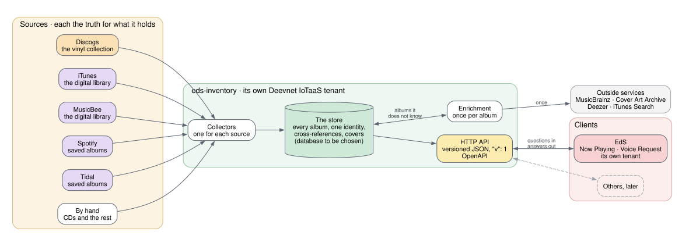

# Sources, Store and Clients

A first picture, drawn before anything is built. It shows the shape the
requirements so far describe, and will change as they settle.

## Sources

Where the owner's music is kept today. Each stays the truth for what it
holds.

| Source | Holds | Read by |
|---|---|---|
| **Discogs** | the vinyl collection | its API (open) |
| **iTunes** | the digital library | its library XML (open) |
| **MusicBee** | the digital library | open |
| **Spotify** | saved albums | its Web API (open) |
| **Tidal** | saved albums | open |
| **By hand** | CDs and anything else with no service behind it | open |

## Collecting

One collector for each source reads what it holds and keeps the inventory in
step with it. How often, or on what signal, is open.

## The store

One database holds every album, its identity and cross-references, and what
enrichment found. What kind is open; SQLite may be enough for one owner's
collection.

## Enrichment

When the inventory meets an album it does not know, it asks the services
that know about music, once:

| Service | For |
|---|---|
| **MusicBrainz** | what the album is, its original release, and the artist's discography |
| **Cover Art Archive** | the cover, where its terms allow it to be kept |
| **Deezer**, **iTunes Search** | finding an album, and a cover when the others have none |

## Clients

Clients ask over HTTP, with a versioned contract. The first is EdS, for its
Now Playing and Voice Request subsystems.

The picture is drawn by GraphViz from `system.dot`, beside this page. Change
it there and run `make -C docs diagrams`; both files are committed, because
the site is built without GraphViz.
