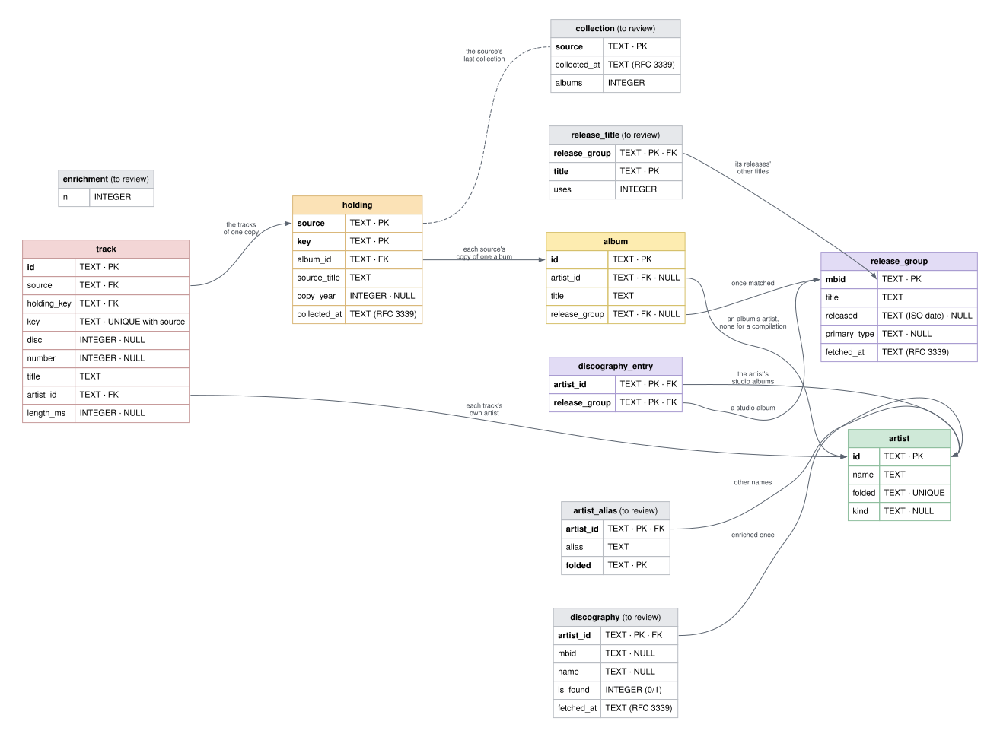

# Proposed Schema

**Not built.** This is the database as it is being reworked, table by table,
in conversation with the owner (started 2026-10-24). The tables reviewed so
far are in color; those still to be reviewed are gray, carried over with
their new names and conventions only. When the review is done, the schema is
rebuilt as one clean version 1, the workload's database is wiped, and the
library collected again. Until then, [Database Schema](../schema/) is what
runs.

[](schema-proposed.svg)

## What changes, and why

1. **Table and index names are singular**: `artist`, `album`, `holding`, and
   so on.
2. **Conventions, for every table**: a flag is named `is_…`; what is not
   known is `NULL`, never `0` or `''`; a time is RFC 3339 in UTC, in a column
   named `…_at`.
3. **An artist has a kind**: `person`, `group`, `orchestra`, `choir`,
   `character` or `other`, as MusicBrainz says, which answers band or solo.
   It comes from the artist search the enricher already makes.
4. **An album's date is its original release, without exception.** *Are You
   Experienced* and *Sgt. Pepper's* are 1967 whatever the copy says. It is
   MusicBrainz's, kept on the release group. The year a source gives is the
   copy's, and moves to the holding as `copy_year`.
5. **A title is kept once for each thing it names.** `album.title` is the
   album's name (MusicBrainz's once matched, the first source's until then);
   `holding.source_title` is what that source calls its copy, which is what a
   player must be asked for ("Toys in the Attic - 2013 Remaster").
6. **Tracks are kept, on the holding**, since an edition's tracks are its
   own: a deluxe reissue has twenty, the LP nine. **A track's artist is
   required and an album's is optional**, so a K-tel record is an album with
   no artist and a track list of many. `is_compilation` goes, since no album
   artist says the same thing, and `holding.tracks` goes, since it is a
   count of `track`.
7. **What MusicBrainz says of an album is a table of its own**,
   `release_group`, that an album may point to once the enricher has matched
   it. The match is kept, not worked out each time, and survives a new
   collection with the album's ID.
8. **An artist's studio albums are `discography_entry` rows**, the artist and
   a release group, with no stored position: the order comes from the dates.

## Views

**`album_by_date`**: the owner's albums, by artist, then original release.
An album not matched yet comes last for its artist, never placed by its
copy's year.

```sql
SELECT ar.name AS artist, al.title, rg.released
FROM album al
JOIN artist ar ON ar.id = al.artist_id
LEFT JOIN release_group rg ON rg.mbid = al.release_group
ORDER BY ar.folded, rg.released IS NULL, rg.released, al.title;
```

**`discography_in_order`**: each artist's studio albums, numbered by date,
with the owner's copy beside each one owned. "Genesis' third album" is
counted against all of them, then the first owned from there is played, and
the next two named for `instead`.

```sql
SELECT d.artist_id, rg.title, rg.released,
       ROW_NUMBER() OVER (PARTITION BY d.artist_id
                          ORDER BY rg.released, rg.title) AS n,
       al.id AS owned_album
FROM discography_entry d
JOIN release_group rg ON rg.mbid = d.release_group
LEFT JOIN album al ON al.release_group = d.release_group;
```

A date MusicBrainz knows only to the year (`1967`) sorts before one it knows
to the day (`1967-05-12`); a tie falls to the title.

## Data dictionary, reviewed tables

### `artist`

| Column | Type | Null | Meaning |
|---|---|---|---|
| `id` | TEXT | no | **Primary key.** `ar_` and twelve hex digits, the inventory's own |
| `name` | TEXT | no | The name as first collected |
| `folded` | TEXT | no | **Unique.** The name as names are compared (`fold.Name`) |
| `kind` | TEXT | yes | MusicBrainz's artist type, lowercase; `NULL` until enriched or when not found |

### `album`

| Column | Type | Null | Meaning |
|---|---|---|---|
| `id` | TEXT | no | **Primary key.** `al_` and twelve hex digits, kept across collections |
| `artist_id` | TEXT | yes | **Foreign key** to `artist.id`; `NULL` for a compilation of many artists |
| `title` | TEXT | no | The album's name: MusicBrainz's once matched, else the first source's |
| `release_group` | TEXT | yes | **Foreign key** to `release_group.mbid`, once the enricher has matched it |

### `holding`

| Column | Type | Null | Meaning |
|---|---|---|---|
| `source` | TEXT | no | **Primary key, with `key`.** The source, by name: `itunes` |
| `key` | TEXT | no | **Primary key, with `source`.** What the source knows the copy by |
| `album_id` | TEXT | no | **Foreign key** to `album.id` |
| `source_title` | TEXT | no | The title as this source spells it; what a player is asked for |
| `copy_year` | INTEGER | yes | The year the source gives this copy, often a reissue's |
| `collected_at` | TEXT | no | When the collection that last saw it ran |

### `track`

| Column | Type | Null | Meaning |
|---|---|---|---|
| `id` | TEXT | no | **Primary key.** `tr_` and twelve hex digits |
| `source` | TEXT | no | **Foreign key, with `holding_key`,** to the holding the track is on |
| `holding_key` | TEXT | no | The holding's `key` |
| `key` | TEXT | no | **Unique, with `source`.** What the source knows the track by: iTunes' Persistent ID |
| `disc` | INTEGER | yes | The disc it is on |
| `number` | INTEGER | yes | Its number on the disc |
| `title` | TEXT | no | The track's title, as the source spells it |
| `artist_id` | TEXT | no | **Foreign key** to `artist.id`: the track's own artist |
| `length_ms` | INTEGER | yes | Its length in milliseconds |

### `release_group`

| Column | Type | Null | Meaning |
|---|---|---|---|
| `mbid` | TEXT | no | **Primary key.** MusicBrainz's release group ID: the album, across every edition |
| `title` | TEXT | no | Its name, as MusicBrainz writes it |
| `released` | TEXT | yes | Its first release: an ISO date to the precision known (`1967`, `1967-05`, `1967-05-12`) |
| `primary_type` | TEXT | yes | `album`, `ep`, `single` and so on |
| `fetched_at` | TEXT | no | When it was asked for |

### `discography_entry`

| Column | Type | Null | Meaning |
|---|---|---|---|
| `artist_id` | TEXT | no | **Primary key, with `release_group`.** **Foreign key** to `artist.id` |
| `release_group` | TEXT | no | **Foreign key** to `release_group.mbid`: one of the artist's studio albums |

## Still to review

`collection`, `discography`, `artist_alias`, `release_title` and
`enrichment`, as drawn above. Open questions noted so far:

- **Two artists who fold alike are one.** "Genesis" was also a 1960s Los
  Angeles group. Left as a known limit for now; the cure would key an artist
  by MusicBrainz ID once enriched.
- **A featured artist is kept as written**: "Santana feat. Rob Thomas" is an
  artist of its own until credits are split, which MusicBrainz's artist
  credits could do.
- **An album's kind** (live, compilation, soundtrack) is MusicBrainz's
  `primary_type` and secondary types; whether to keep the secondary types.
- **Compilations by no one artist** are not in `album_by_date`; whether they
  need an order of their own.
- **What leaves the Mac grows**: the deploy would send track titles, numbers
  and lengths beside the albums, still with no paths or play counts.
