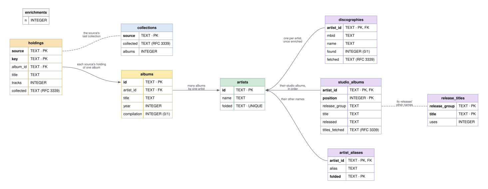

# Database Schema

The inventory's database, as `internal/store` creates it: SQLite, schema
version **2** (kept in `PRAGMA user_version`). Nothing but `internal/store`
reads or writes it
([ADR-0001](/docs/architecture/decisions/0001-go-services-and-a-sqlite-store/)).

**An album is the inventory's; a holding is a source's.** Each source that
holds an album has a holding of it, found again on every collection by the
key the source knows it by, so the album keeps its ID. A collection replaces
its source's holdings; an album no holding refers to is removed, and then
an artist with no albums.

**What MusicBrainz knows is kept beside them** (version 2,
[ADR-0004](/docs/architecture/decisions/0004-discographies-are-enriched-once-from-musicbrainz/)):
an artist's discography, aliases and albums' other names. All of it belongs
to the artist and is removed with them (`ON DELETE CASCADE`). Which owned
album each studio album is, is worked out when asked, not kept, so a new
collection never leaves it stale.

The picture is drawn by GraphViz from `schema.dot`, beside this page. Change
it, this dictionary and `internal/store/store.go` together; a test fails if
a column is missing here.

## Data dictionary

### `artists`

Each artist with albums in the inventory. Two spellings that fold alike
("The Beatles", "Beatles") are one artist.

| Column | Type | Null | Meaning |
|---|---|---|---|
| `id` | TEXT | no | **Primary key.** The inventory's own ID: `ar_` and twelve lowercase hex digits, random, never reused. What clients hold on to |
| `name` | TEXT | no | The name as first collected, as a source spells it |
| `folded` | TEXT | no | **Unique.** The name as names are compared (`fold.Name`): lowercase, without accents, a leading "the" or punctuation, "&" as "and". How a second spelling finds the same artist |

### `albums`

Each album in the inventory, whatever holds it.

| Column | Type | Null | Meaning |
|---|---|---|---|
| `id` | TEXT | no | **Primary key.** The inventory's own ID: `al_` and twelve lowercase hex digits. Kept across collections |
| `artist_id` | TEXT | no | **Foreign key** to `artists.id`: the album's artist, the album artist where a source names one |
| `title` | TEXT | no | The title as the source spells it, so a player asked for it by name finds it |
| `year` | INTEGER | no | The year most of its tracks give; 0 when none does. Often a reissue's |
| `compilation` | INTEGER | no | 1 when the source marks it a compilation, else 0. A compilation is never an album asked for by its place |

### `holdings`

One source's holding of one album: that the source has it, and what the
source says of it.

| Column | Type | Null | Meaning |
|---|---|---|---|
| `source` | TEXT | no | **Primary key, with `key`.** The source, by name: `itunes` |
| `key` | TEXT | no | **Primary key, with `source`.** What the source knows the album by, the same on every collection. For iTunes, which gives albums no ID, the folded artist and title: `beatles\|abbey road` |
| `album_id` | TEXT | no | **Foreign key** to `albums.id`: the album held |
| `title` | TEXT | no | The title as this source spells it |
| `tracks` | INTEGER | no | How many of the album's tracks the source has |
| `collected` | TEXT | no | When the collection that last saw it ran, RFC 3339 in UTC. A holding whose time is not its source's latest collection is removed by it |

### `collections`

The last collection of each source.

| Column | Type | Null | Meaning |
|---|---|---|---|
| `source` | TEXT | no | **Primary key.** The source, by name |
| `collected` | TEXT | no | When its last collection ran, RFC 3339 in UTC |
| `albums` | INTEGER | no | How many albums that collection held |

### `discographies`

That an artist has been enriched, and what MusicBrainz said of them. One
row per artist, once asked for.

| Column | Type | Null | Meaning |
|---|---|---|---|
| `artist_id` | TEXT | no | **Primary key; foreign key** to `artists.id`, removed with the artist |
| `mbid` | TEXT | no | MusicBrainz's artist ID, or `''` when it knows no such artist |
| `name` | TEXT | no | The artist as MusicBrainz names them, or `''` |
| `found` | INTEGER | no | 1 when MusicBrainz has the artist and at least one studio album by them; 0 when it answered and had nothing, which is kept, and the owner's albums are then counted by year |
| `fetched` | TEXT | no | When it was asked, RFC 3339 in UTC. Asked again after thirty days |

### `studio_albums`

An artist's studio albums, in the order they were first released, by EdS's
rules: an album with no secondary type, with an official release, credited
to the artist alone.

| Column | Type | Null | Meaning |
|---|---|---|---|
| `artist_id` | TEXT | no | **Primary key, with `position`; foreign key** to `artists.id`, removed with the artist |
| `position` | INTEGER | no | **Primary key, with `artist_id`.** 1 for the first; albums with no date last |
| `release_group` | TEXT | no | MusicBrainz's release group ID: the album, whatever its releases are called |
| `title` | TEXT | no | As MusicBrainz names it, with straight quotes and an untitled album's brackets taken off |
| `released` | TEXT | no | Its first release, `YYYY[-MM[-DD]]`, or `''` |
| `titles_fetched` | TEXT | no | When its releases' names were asked for, RFC 3339 in UTC, or `''`: asked only while an owned album is not found under a studio album's own title |

### `release_titles`

The names an album's releases have gone by, other than its own: Genesis'
first, *From Genesis to Revelation*, is in the owner's library as its
reissue, *And The Word Was*.

| Column | Type | Null | Meaning |
|---|---|---|---|
| `release_group` | TEXT | no | **Primary key, with `title`.** The album, as `studio_albums.release_group` |
| `title` | TEXT | no | **Primary key, with `release_group`.** One name its releases have had |
| `uses` | INTEGER | no | How many of its releases have that name; the most used is looked for first |

### `artist_aliases`

The other names MusicBrainz knows an artist by, which find them as their own
name does: "Leonard Skinner" is Lynyrd Skynyrd.

| Column | Type | Null | Meaning |
|---|---|---|---|
| `artist_id` | TEXT | no | **Primary key, with `folded`; foreign key** to `artists.id`, removed with the artist |
| `alias` | TEXT | no | The name as MusicBrainz writes it |
| `folded` | TEXT | no | **Primary key, with `artist_id`.** The name as names are compared |

### `enrichments`

One row, one number.

| Column | Type | Null | Meaning |
|---|---|---|---|
| `n` | INTEGER | no | How many enrichments have been kept. It moves with each, so a reader of the inventory knows to read it again |

### Indexes

| Index | On | For |
|---|---|---|
| `albums_by_artist` | `albums(artist_id)` | an artist's albums |
| `holdings_by_album` | `holdings(album_id)` | an album's holdings, and finding albums nothing holds |
| `studio_albums_by_group` | `studio_albums(release_group)` | the studio album a release group's names belong to |

### What is not kept

No paths, play counts, ratings or anything else a source knows of how its
music is listened to. Covers are not kept yet; they come with a later
enrichment.
